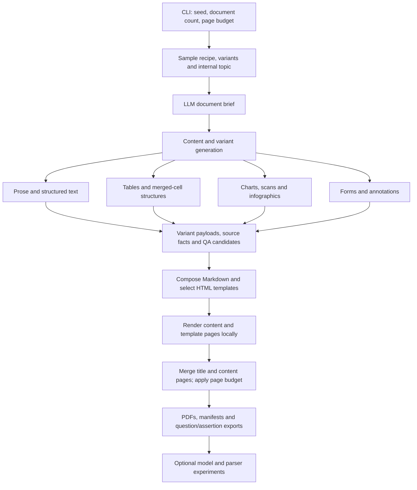

# SynthDocQA

**Generate synthetic PDFs and question-answer datasets for document understanding research.**

SynthDocQA combines sampled document structures, LLM-generated content, and local PDF rendering to produce documents with structured ground truth, questions, expected answers, and evaluation assertions. It supports business-style prose, complex tables, charts, forms, scanned pages, handwriting, and infographics.

The repository also includes experiments for comparing question-answering models across source Markdown, native PDFs, page images, and parser-extracted Markdown.

## Architecture



### Generation workflow

1. **Sample a document configuration.** A seed drives local recipe, variant, and page-budget sampling. Topics are selected internally from the packaged topic pool; the public CLI does not take a source document or user-supplied topic.
2. **Generate content and source facts.** An Azure OpenAI client produces a document brief and content for enabled variant families. Generation jobs run concurrently. Structured source data supplies both rendering payloads and QA context.
3. **Compose and render.** The composer selects variants, numbers tables and figures, and builds Markdown. The mixed-document builder renders the Markdown content, replaces selected pages with Jinja2 template pages, prepends a styled title page, and merges the PDFs. Playwright/Chromium is the default renderer.
4. **Write dataset artifacts.** The pipeline writes final PDFs, per-document manifests, a run summary, and question/assertion exports. QA candidates are generated during content creation and aggregated for export; they are not produced by re-parsing the final PDF.

“Batch generation” describes how the dataset is produced: LLM calls require access to your configured service, while composition, image generation, and PDF rendering run locally.

### Components

| Component | Responsibility |
|---|---|
| [`cli.py`](src/synthpdf/cli.py) | Public `synthpdf generate` command. |
| [`document_generator.py`](src/synthpdf/document_generator.py) | Random configuration sampling, connection settings, and batch invocation. |
| [`_pipeline.py`](src/synthpdf/_pipeline.py) | Document orchestration, concurrent variant generation, composition, rendering, and exports. |
| [`types.py`](src/synthpdf/types.py) and [`rng.py`](src/synthpdf/rng.py) | Variant/document specifications and seeded random streams. |
| [`llm/`](src/synthpdf/llm) | Azure OpenAI authentication, deployment routing, prompts, content generation, and QA generation. |
| [`variants/`](src/synthpdf/variants) | Content builders, structured facts, visual assets, and perturbations. |
| [`compose/`](src/synthpdf/compose) | Markdown composition and section templates. |
| [`template_engine/`](src/synthpdf/template_engine) | Template indexing, content adapters, mixed-page assembly, and title pages. |
| [`render/`](src/synthpdf/render) | Markdown/HTML-to-PDF rendering, neutral branding, and PDF annotation utilities. |
| [`shared/handwriting.py`](src/synthpdf/shared/handwriting.py) | Local handwriting rendering using bundled fonts. |
| [`manifest.py`](src/synthpdf/manifest.py) | Per-document ground truth, run summaries, and question/assertion export formats. |
| [`resources/`](src/synthpdf/resources) | Local templates, template specifications, topics, neutral logo placeholders, and fonts. |

## Content families

The random configuration determines which content families appear in a batch; a document does not necessarily contain every family.

| Family | Examples and capabilities |
|---|---|
| Text | Topic-aware prose, emails, policies, specifications, bullet lists, and footnotes. |
| Tables | Basic and multipage tables, grouped headers, subtotals, and structured cell data. |
| Complex tables | LLM-generated hierarchical, nested, transposed, and merged-cell layouts with span-related QA. |
| Charts | Grouped bars, violin plots, heatmaps, stacked areas, bubble scatter plots, and density plots. |
| Forms | Checklists, button groups, forms, and fillable/filled-form builders. |
| Scanned documents | Text pages, data tables, handwritten notes, stamps, and annotated pages, with scan and paper effects. |
| Infographics | Dashboards, timelines, comparisons, process steps, hub-and-spoke diagrams, magazine layouts, pictographs, and floor plans. |
| Annotations | Highlighted text, callouts, labels, review blocks, colored tables, and PDF annotation utilities. |

Content builders also support perturbations such as text noise, image blur, rotation, contrast changes, and scan artifacts. Some utilities have internal configuration options that are not exposed by the public generation CLI.

## Quickstart

### 1. Install

Use Python **3.10 or later** and a virtual environment. From the repository root, on Windows:

```powershell
py -3.12 -m venv .venv
.\.venv\Scripts\Activate.ps1
python -m pip install -e .
python -m playwright install chromium
```

Chromium is downloaded during browser setup. Templates, topics, neutral logo placeholders, and handwriting fonts are included in the Python package.

Optional fallback renderers can be installed with:

```powershell
python -m pip install -e ".[fallback-renderers]"
```

WeasyPrint may require platform-specific native libraries. Installing fallback renderers does not change the default Playwright backend.

### 2. Configure model access

Copy [.env.example](.env.example) to `.env` in the working directory and supply your Azure OpenAI settings:

```powershell
Copy-Item .env.example .env
```

Alternatively, set environment variables directly:

```powershell
$env:AZURE_OPENAI_ENDPOINT = "https://<your-resource>.openai.azure.com/"
$env:AZURE_OPENAI_DEPLOYMENT = "<your-deployment>"
$env:AZURE_OPENAI_API_VERSION = "<your-supported-api-version>"
$env:AZURE_OPENAI_API_KEY = "<your-key>"
```

An API key is optional when using the client's Entra ID authentication:

- Set `AZURE_TENANT_ID` for the intended tenant.
- Leave `AZURE_OPENAI_API_KEY` unset and omit `AZURE_OPENAI_ACCESS_TOKEN` to use interactive browser authentication.
- A caller-provided Entra bearer token can instead be supplied through `AZURE_OPENAI_ACCESS_TOKEN`; the caller is responsible for its validity.

Your account must have access to the configured endpoint and deployments. Generation sends synthetic content and QA context to that service and may incur charges. Never commit credentials.

### 3. Generate documents

Start with one document:

```powershell
synthpdf generate --seed 42 --num-documents 1 --pages 8 --output-dir output
```

Generate a larger batch:

```powershell
synthpdf generate --seed 42 --num-documents 20 --pages 8 --output-dir output_batch
```

The module entry point is equivalent:

```powershell
python -m synthpdf generate --seed 42 --num-documents 1 --pages 8 --output-dir output
```

| Option | Meaning |
|---|---|
| `--seed` | Local sampling seed, from 0 to 2147483647. Random when omitted. |
| `--num-documents`, `-n` | Positive document count. Randomly chosen from 2–6 when omitted. |
| `--pages`, `-p` | Positive page budget per document. Randomly chosen from 4–20 for the batch when omitted. |
| `--output-dir`, `-o` | Output directory. Defaults to a timestamped run under `output\generated` in the working directory. |

Use `synthpdf generate --help` for the command reference. A seed controls local random sampling, not deterministic LLM responses or byte-identical PDFs. Page counts are managed by layout heuristics and a final page cap, not by an exact-length content guarantee.

### Model tiers

The generator routes calls through three deployment tiers:

| Tier | Environment variable | Representative calls |
|---|---|---|
| EASY | `AZURE_OPENAI_DEPLOYMENT_EASY` | Prose, titles, subtitles, and structured-element questions. |
| MEDIUM | `AZURE_OPENAI_DEPLOYMENT_MEDIUM` | Table data, chart specifications, and generic QA candidates. |
| HARD | `AZURE_OPENAI_DEPLOYMENT_HARD` | Document briefs and complex-table generation. |

All overrides are optional. HARD defaults to `AZURE_OPENAI_DEPLOYMENT`; MEDIUM defaults to HARD; EASY defaults to MEDIUM. The public connection settings do not currently configure PRO/FAST routes or reasoning effort.

## Dataset outputs

```text
output\
  config.yaml                 # sampled configuration; no API key
  manifest.jsonl              # one run-summary record per document
  pdfs\
    <doc_id>.pdf              # final document
  manifests\
    <doc_id>.json             # structure, variant metadata and QA candidates
  quest\
    <doc_id>.json             # questions, file/artifact references and assertions
    <doc_id>.xlsx             # QUERIES and FILES worksheets
    <doc_id>.tsv              # query/segment/annotation/tags export
    <doc_id>.yml              # questions and assertions
  markdown\                   # intermediate composed sources
  assets\                     # generated visual assets
  _tmp_pages\                 # intermediate page PDFs and HTML
  stats\                      # local run statistics
```

Per-document manifests include document identity, sampled topic, seed, recipe, document brief, file references, render information, structured elements, variant metadata, and QA candidates. Available ground truth varies by content family.

Question JSON records contain `Id`, `query`, `refs`, and `assertions`. References identify the PDF and source artifact; assertions describe the expected response. IDs are assigned per document, so use the document ID together with the question ID when combining runs.

Outputs are generated locally and are excluded from version control. Review paths, generated content, and service error details before sharing them.

## Evaluation experiments

The [experiment guide](experiments/README.md) provides independent execution workflows:

| Workflow | Model input | Guide |
|---|---|---|
| Source-Markdown baseline | Composed source Markdown and generated questions. | [`pdf_qna`](experiments/pdf_qna/README.md) |
| Native PDF QA | Uploaded PDFs and question records from a baseline run. | [`pdf_qna_with_images`](experiments/pdf_qna_with_images/README.md#native-uploaded-pdf) |
| Page-image QA | Question-selected PDF pages rendered as images. | [`pdf_qna_with_images`](experiments/pdf_qna_with_images/README.md#selected-page-image-inference) |
| Parser extraction | PDFs parsed with Docling, MinerU, pdfplumber, or pymupdf4llm, evaluated against manifests. | [`pdf_parsers`](experiments/pdf_parsers/README.md) |
| Parser-Markdown QA | Parser-generated Markdown, followed by separate model judging. | [`pdf_qna_with_parser`](experiments/pdf_qna_with_parser/README.md) |

Each route has its own dependencies, model configuration, input layout, and output directory. Experiment dependencies are not installed with the generator. Dataset inputs, predictions, parser outputs, and historical scores are not bundled.

Install the requirements for the chosen parser. The [MinerU runner](experiments/pdf_parsers/mineru/README.md) uses `mineru[pipeline]==3.4.5` and `six>=1.16`; its Python API is not compatible with MinerU 4.x. The example model configuration defines one judge, so the [parser-QA judge command](experiments/pdf_qna_with_parser/README.md) explicitly selects `--judges judge_1`.

## Interpreting generated ground truth

Questions and assertions are derived from source content, including LLM-generated facts. They should be checked against the **final PDF** before being treated as benchmark labels. Page replacement or trimming can remove referenced content, and rendering or model output can introduce mismatches. Manifest consistency alone does not establish final-document answerability.

Judge verdicts assess predictions against the supplied assertions; they do not independently certify those assertions. Source-Markdown results and parser-Markdown results measure different inputs, especially when answers occur inside raster figures or scanned pages.

## Development

```powershell
python -m pip install -e ".[dev]"
python -m playwright install chromium
python -m pytest
python -m build
```

The tests cover the public CLI, resource packaging, credential-safe configuration, and PDF/export smoke behavior with replayed content. Live generation requires your own authorized model service. See [CONTRIBUTING.md](CONTRIBUTING.md) for development and contribution guidance.

## Data and service calls

Generation and model-based experiments send prompts, content, and, for visual workflows, PDFs or page images to the configured service. Local timing metrics are retained in memory or written to local files; the project does not include an outbound telemetry collector. SDK and provider data-handling behavior is governed by their own terms.

## Contributing and support

Contributions and suggestions are welcome. Read [CONTRIBUTING.md](CONTRIBUTING.md) for the Microsoft Contributor License Agreement process, [SUPPORT.md](SUPPORT.md) for help, and [SECURITY.md](SECURITY.md) for private vulnerability reporting.

This project has adopted the [Microsoft Open Source Code of Conduct](https://opensource.microsoft.com/codeofconduct/).
For more information see the [Code of Conduct FAQ](https://opensource.microsoft.com/codeofconduct/faq/)
or contact [opencode@microsoft.com](mailto:opencode@microsoft.com) with any additional questions or comments.
See also [CODE_OF_CONDUCT.md](CODE_OF_CONDUCT.md).

## License and third-party software

SynthDocQA source code is licensed under the [MIT License](LICENSE.txt), except where otherwise indicated. Bundled fonts and other third-party components retain their own licenses. [NOTICE.md](NOTICE.md) describes included third-party software and assets, their licenses, and the distinction between bundled assets and separately installed dependencies.

## Trademarks

This project may contain trademarks or logos for projects, products, or services. Authorized use of Microsoft trademarks or logos is subject to and must follow [Microsoft's Trademark & Brand Guidelines](https://www.microsoft.com/legal/intellectualproperty/trademarks/usage/general). Use of Microsoft trademarks or logos in modified versions of this project must not cause confusion or imply Microsoft sponsorship. Any use of third-party trademarks or logos are subject to those third-party's policies.
