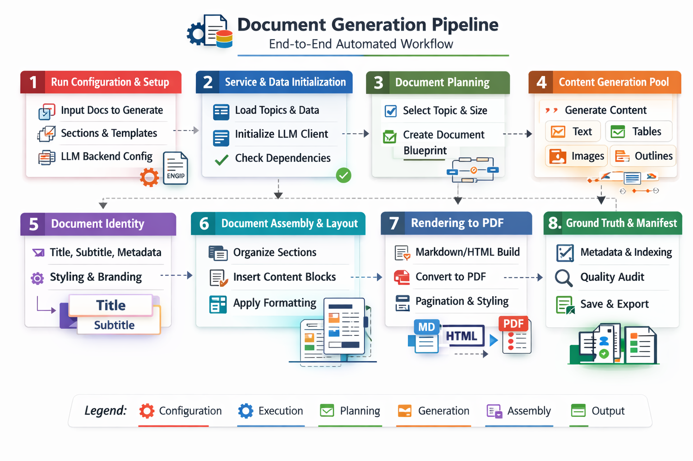

# SynthDocQA

Official implementation of the paper **SynthDocQA: Infinite Ground Truth for File-Grounded Enterprise LLM Evaluation**.

> [!TIP]
> Question: Ready to ship your AI model, but running out of challenging evaluation set to test it on?
>
> Answer: Don't let limited evaluation data limit your confidence. **SynthDocQA generates diverse synthetic PDFs and question-answer datasets with structured ground truth, helping you stress-test document understanding before production.**

SynthDocQA combines sampled document structures, LLM-generated content, and local PDF rendering to produce documents with structured ground truth, questions, expected answers, and evaluation assertions. It supports business-style prose, complex tables, charts, forms, scanned pages, handwriting, and infographics.

The repository also includes experiments for comparing question-answering models across source Markdown, native PDFs, page images, and parser-extracted Markdown.

## Contents

- [Quickstart](#quickstart)
- [Using the Python API](#using-the-python-api)
- [Architecture](#architecture)
- [Content families](#content-families)
- [Configuration and reproducibility](#configuration-and-reproducibility)
- [Template engine and rendering](#template-engine-and-rendering)
- [Dataset outputs](#dataset-outputs)
- [Evaluation experiments](#evaluation-experiments)
- [Interpreting generated ground truth](#interpreting-generated-ground-truth)
- [Troubleshooting](#troubleshooting)
- [Repository structure](#repository-structure)
- [Development](#development)
- [License and third-party software](#license-and-third-party-software)


## Quickstart

### 1. Install

Use Python **3.10 or later** and a virtual environment. From the repository root, on Windows:

```powershell
py -3.12 -m venv .venv
.\.venv\Scripts\Activate.ps1
python -m pip install -e .
python -m playwright install chromium
```

Chromium is downloaded during browser setup. Templates, topics, neutral logo placeholders, and handwriting fonts are included in the Python package.

Optional fallback renderers can be installed with:

```powershell
python -m pip install -e ".[fallback-renderers]"
```

WeasyPrint may require platform-specific native libraries. Installing fallback renderers does not change the default Playwright backend.

### 2. Configure model access

Copy [.env.example](.env.example) to `.env` in the working directory and supply your Azure OpenAI settings:

```powershell
Copy-Item .env.example .env
```

Alternatively, set environment variables directly:

```powershell
$env:AZURE_OPENAI_ENDPOINT = "https://<your-resource>.openai.azure.com/"
$env:AZURE_OPENAI_DEPLOYMENT = "<your-deployment>"
$env:AZURE_OPENAI_API_VERSION = "<your-supported-api-version>"
$env:AZURE_OPENAI_API_KEY = "<your-key>"
```

An API key is optional when using the client's Entra ID authentication:

- Set `AZURE_TENANT_ID` for the intended tenant.
- Leave `AZURE_OPENAI_API_KEY` unset and omit `AZURE_OPENAI_ACCESS_TOKEN` to use interactive browser authentication.
- A caller-provided Entra bearer token can instead be supplied through `AZURE_OPENAI_ACCESS_TOKEN`; the caller is responsible for its validity.

Your account must have access to the configured endpoint and deployments. Generation sends synthetic content and QA context to that service and may incur charges. Never commit credentials.

### 3. Generate documents

Start with one document:

```powershell
synthpdf generate --seed 42 --num-documents 1 --pages 8 --output-dir output
```

Generate a larger batch:

```powershell
synthpdf generate --seed 42 --num-documents 20 --pages 8 --output-dir output_batch
```

The module entry point is equivalent:

```powershell
python -m synthpdf generate --seed 42 --num-documents 1 --pages 8 --output-dir output
```

| Option | Meaning |
|---|---|
| `--seed` | Local sampling seed, from 0 to 2147483647. Random when omitted. |
| `--num-documents`, `-n` | Positive document count. Randomly chosen from 2–6 when omitted. |
| `--pages`, `-p` | Positive page budget per document. Randomly chosen from 4–20 for the batch when omitted. |
| `--output-dir`, `-o` | Output directory. Defaults to a timestamped run under `output\generated` in the working directory. |

Use `synthpdf generate --help` for the command reference. A seed controls local random sampling, not deterministic LLM responses or byte-identical PDFs. Page counts are managed by layout heuristics and a final page cap, not by an exact-length content guarantee.

### Model tiers

The generator routes calls through three deployment tiers:

| Tier | Environment variable | Representative calls |
|---|---|---|
| EASY | `AZURE_OPENAI_DEPLOYMENT_EASY` | Prose, titles, subtitles, and structured-element questions. |
| MEDIUM | `AZURE_OPENAI_DEPLOYMENT_MEDIUM` | Table data, chart specifications, and generic QA candidates. |
| HARD | `AZURE_OPENAI_DEPLOYMENT_HARD` | Document briefs and complex-table generation. |

All overrides are optional. HARD defaults to `AZURE_OPENAI_DEPLOYMENT`; MEDIUM defaults to HARD; EASY defaults to MEDIUM. The public connection settings do not currently configure PRO/FAST routes or reasoning effort.

## Using the Python API

After installation, call the same unconditional batch wrapper from Python:

```python
from synthpdf.document_generator import generate_documents

result = generate_documents(
    num_pages=8,
    num_pdfs=3,
    seed=42,
    output_dir="output_python",
)

print(result["output_dir"])
print(result["config_path"])
print(result["manifest_jsonl"])
print(result["elapsed_seconds"])

for document in result["documents"]:
    print(document["doc_id"])
    print(document["pdf_path"])
    print(document["manifest_path"])
    print(document["quest_json_path"])
    print(document["quest_xlsx_path"])
    print(document["markdown_path"])
```

The wrapper returns `Path` objects for output locations and per-document files. Optional files may be `None`; in particular, mixed composition does not populate every Markdown reference in the same way as the plain-Markdown route. Use the actual files and manifests when consuming a run.

With omitted arguments, the wrapper samples a document count and page budget, creates a timestamped output directory, and records the generated configuration. Both the API and CLI require the model connection settings described above.


## Architecture



The architecture separates **content generation**, **document presentation**, and **evaluation**. Source facts and QA candidates accompany the content through the pipeline, while Markdown and HTML templates provide multiple layout styles. The diagram's quality-audit stage represents the review and evaluation of exported artifacts; generation alone does not certify the correctness of every answer.

### End-to-end generation workflow

| Stage | What happens | Main implementation |
|---|---|---|
| 1. Run configuration | Read the seed, document count, page budget, output location, and model connection settings. Sample the variant mix and recipe. | `cli.py`, `document_generator.py` |
| 2. Service and data initialization | Initialize Azure OpenAI access and load the packaged topic/template resources. | `llm/client.py`, `resources/` |
| 3. Document planning | Sample a topic for each document, estimate section counts from the page budget, and generate a narrative brief with section headings, key facts, table purposes, and chart descriptions. | `_pipeline.py`, `llm/content_generator.py` |
| 4. Content generation | Run enabled text, table, chart, form, scan, infographic, and annotation builders in concurrent jobs. Each variant carries a render payload and source ground truth. | `variants/` |
| 5. Document identity | Generate a title/subtitle and select a synthetic organization identity, palette, and neutral logo placeholder. | `llm/content_generator.py`, `render/branding.py`, `template_engine/doc_builder.py` |
| 6. Assembly and layout | Select content from shuffled variant queues, number captions, build Markdown, and fill selected Jinja2 pages. | `compose/`, `template_engine/` |
| 7. PDF rendering | Render content and template pages, prepend a title page, merge pages, and apply the final page cap. | `render/`, `_pipeline.py` |
| 8. Ground truth and exports | Write the document manifest, run summary, and JSON/XLSX/TSV/YAML question/assertion files. | `manifest.py` |

The public command runs the **mixed-document route** when the packaged templates are available. Markdown composition supplies the main content; roughly 10% of its rendered pages, with at least one selected page when available, are replaced by HTML template pages. A styled title page is then prepended. If mixed assembly fails, the configured pipeline can fall back to Markdown rendering.

The Markdown route also contains a page-shortfall fill loop: when an LLM-backed Markdown document is shorter than its target, additional prose can be inserted at randomized positions and re-rendered for up to three passes. This loop is not applied to successful mixed-document builds.

“Batch generation” describes how the dataset is produced: LLM calls require access to your configured service, while composition, image generation, and PDF rendering run locally.

### Content representations and QA lifecycle

The generator uses three lightweight representations rather than a separate authoring format:

- **`Variant`** holds an artifact ID, content kind, metadata, rendering payload, and ground-truth dictionary.
- **`SectionSpec`** describes a document section's type, selected variant IDs, and layout metadata.
- **`DocumentSpec`** holds document identity, seed, recipe, section sequence, title, and subtitle.

Variant generators create the content and QA context together. For example, a table can carry headers, cells, derived values, and questions; a scanned note carries its text/specification and QA; a chart carries its specification and rendering metadata. Questions may be produced analytically, by an LLM, or from complex-table merge facts.

Composition consumes shuffled per-type queues to avoid repeating the same variant through ordinary section selection. An exhausted queue is skipped instead of being cycled. Template replacement can independently sample source variants, so this is not a guarantee of document-wide semantic uniqueness.

QA candidates are generated during content creation and aggregated for export; they are **not** produced by re-parsing the final PDF. See [Interpreting generated ground truth](#interpreting-generated-ground-truth) for the distinction between source facts and final-document support.

### Components

| Component | Responsibility |
|---|---|
| [`cli.py`](src/synthpdf/cli.py) | Public `synthpdf generate` command. |
| [`document_generator.py`](src/synthpdf/document_generator.py) | Random configuration sampling, connection settings, and batch invocation. |
| [`_pipeline.py`](src/synthpdf/_pipeline.py) | Document orchestration, concurrent variant generation, composition, rendering, and exports. |
| [`types.py`](src/synthpdf/types.py) and [`rng.py`](src/synthpdf/rng.py) | Variant/document specifications and seeded random streams. |
| [`llm/`](src/synthpdf/llm) | Azure OpenAI authentication, deployment routing, prompts, content generation, and QA generation. |
| [`variants/`](src/synthpdf/variants) | Content builders, structured facts, visual assets, and perturbations. |
| [`compose/`](src/synthpdf/compose) | Markdown composition and section templates. |
| [`template_engine/`](src/synthpdf/template_engine) | Template indexing, content adapters, mixed-page assembly, and title pages. |
| [`render/`](src/synthpdf/render) | Markdown/HTML-to-PDF rendering, neutral branding, and PDF annotation utilities. |
| [`shared/handwriting.py`](src/synthpdf/shared/handwriting.py) | Local handwriting rendering using bundled fonts. |
| [`manifest.py`](src/synthpdf/manifest.py) | Per-document ground truth, run summaries, and question/assertion export formats. |
| [`resources/`](src/synthpdf/resources) | Local templates, template specifications, topics, neutral logo placeholders, and fonts. |

## Content families

The random configuration determines which content families appear in a batch; a document does not necessarily contain every family.

| Family | Examples and capabilities |
|---|---|
| Text | Topic-aware prose, emails, policies, specifications, bullet lists, and footnotes. |
| Tables | Basic and multipage tables, grouped headers, subtotals, and structured cell data. |
| Complex tables | LLM-generated hierarchical, nested, transposed, and merged-cell layouts with span-related QA. |
| Charts | Grouped bars, violin plots, heatmaps, stacked areas, bubble scatter plots, and density plots. |
| Forms | Checklists, button groups, forms, and fillable/filled-form builders. |
| Scanned documents | Text pages, data tables, handwritten notes, stamps, and annotated pages, with scan and paper effects. |
| Infographics | Dashboards, timelines, comparisons, process steps, hub-and-spoke diagrams, magazine layouts, pictographs, and floor plans. |
| Annotations | Highlighted text, callouts, labels, review blocks, colored tables, and PDF annotation utilities. |

Content builders also support perturbations such as text noise, image blur, rotation, contrast changes, and scan artifacts. Some utilities have internal configuration options that are not exposed by the public generation CLI.

### Tables and complex structures

[`variants/tables.py`](src/synthpdf/variants/tables.py) provides LLM-generated tabular content, local fallback builders, pagination, grouped subtotals, and numeric derived values. Multipage tables divide long row sets into page-sized chunks, with repeated headers and continuation information.

[`variants/complex_tables.py`](src/synthpdf/variants/complex_tables.py) generates structured HTML tables with explicit `rowspan` and `colspan`. Its LLM path samples six structural archetypes:

| Archetype | Structural emphasis |
|---|---|
| `ultra_jagged` | Irregular merged cells and overlapping span patterns. |
| `deep_hierarchy` | Multilevel row/header hierarchies. |
| `nested_annotated` | Nested tables and annotations. |
| `multi_version_stacked` | Stacked versions and grouped comparisons. |
| `transposed_heatmap` | Transposed metric layouts and visual emphasis. |
| `cross_reference_grid` | Cross-referenced row/column groups. |

The renderer applies the generated span structure directly. Questions include those derived from LLM-supplied `merge_facts`, plus additional table QA. Local static builders also cover merged cells, multi-row headers, column groups, group summaries, nested tables, footnotes, matrix layouts, ragged spans, stacked comparisons, and transposed metrics.

### Text and document context

[`variants/text_annotations.py`](src/synthpdf/variants/text_annotations.py) produces prose and structured text blocks such as emails, policies, specifications, bullet lists, and footnotes. Document briefs supply headings, key facts, and references that are intended to connect prose to tables and charts. Text perturbations include typos, abbreviations, punctuation changes, and date-format variations.

The packaged topic pool spans business domains such as finance, operations, people management, technology, compliance, and strategy. One topic is sampled per document. Internal topic context guides the LLM; the public CLI does not expose a topic-file or external-document input.

### Charts and infographics

[`variants/images.py`](src/synthpdf/variants/images.py) uses Matplotlib and seaborn to render chart assets. The LLM supplies chart metadata such as titles, labels, categories, series, value ranges, and intended trends; the renderer constructs the plotted data. Available renderers include grouped bars, violin plots, heatmaps, stacked areas, bubble scatter plots, and density/ridgeline plots.

[`variants/infographics.py`](src/synthpdf/variants/infographics.py) uses Pillow to render eight infographic families: dashboards, timelines, comparisons, process steps, hub-and-spoke diagrams, magazine-style layouts, pictographs, and floor plans. These builders combine structured specifications, locally drawn elements, typography, and color themes.

Both families produce PNG assets embedded in the PDF. Image transformations can add blur, rotation, low contrast, watermarks, or occlusion. Image-based content requires an image-aware model or OCR to evaluate facts that are not available in extracted text.

### Forms, scans, and handwriting

[`variants/forms.py`](src/synthpdf/variants/forms.py) builds checklists, button groups, forms, and fillable/filled-form variants. Their source data includes field descriptions, section structure, checked states, and other element-specific facts. HTML rendering preserves the visual structure of the form; a styled form does not necessarily mean an interactive PDF widget.

[`variants/scanned.py`](src/synthpdf/variants/scanned.py) renders synthetic pages as images, then applies paper and scanner effects. Its builders cover printed text, data tables, handwritten notes, stamped forms, and annotated pages. Effects include skew, noise, paper shading, folds, and varying scan quality. Handwriting uses the [shared local renderer](src/synthpdf/shared/handwriting.py) and bundled OFL-licensed fonts.

### Annotation mechanisms

Annotation utilities support HTML-level visual emphasis, true-PDF annotations, and post-render phrase-based overlays:

| Mechanism | Examples |
|---|---|
| HTML/CSS content | Highlights, callouts, labels, review blocks, and colored tables. |
| PDF annotation layer | Sticky notes and free-text annotations. |
| Inline post-render overlays | Highlights, circles, margin callouts, score callouts, text color, and sticky notes placed by searching rendered text. |

The public random configuration samples annotation variant types. True-PDF and inline passes have separate internal configuration flags; they are not dedicated public CLI options and are not enabled automatically merely because annotation utilities are present.


## Configuration and reproducibility

### Public settings versus generated configuration

The public interface intentionally has four generation controls: seed, count, page budget, and output directory. Model connection settings come from environment variables or the working-directory `.env`. The command does not accept a hand-authored document configuration, custom topic file, or source-document input.

For each run, `config.yaml` records the sampled variant/recipe settings and connection metadata. This is a run record, not a separate public configuration-file entry point. API keys are not written to it; endpoint/deployment names and an optional tenant ID can be present.

| Setting | Source | Role |
|---|---|---|
| Endpoint | `AZURE_OPENAI_ENDPOINT` | Azure OpenAI/Foundry resource URL. |
| Base deployment | `AZURE_OPENAI_DEPLOYMENT` | Required deployment and tier fallback. |
| API version | `AZURE_OPENAI_API_VERSION` | Service API version; defaults to `2024-02-01` when unset. |
| API key | `AZURE_OPENAI_API_KEY` | First authentication choice when set. |
| Entra tenant | `AZURE_TENANT_ID` | Tenant for interactive Entra authentication. |
| Entra bearer token | `AZURE_OPENAI_ACCESS_TOKEN` | Caller-managed token when no API key is supplied. |
| Tier overrides | `AZURE_OPENAI_DEPLOYMENT_HARD`, `_MEDIUM`, `_EASY` | Route generation tasks to different deployments. |

The current connection wrapper constructs the client's internal defaults, including a 16,000-token completion budget, five retries, a 120-second request timeout, and an internal per-document LLM concurrency limit of 12. There are also concurrent jobs across content families, so this is not a global cap on all service requests. These values are not additional CLI flags or automatically configurable through arbitrary `.env` keys.

### Sampled recipe styles

One recipe style is sampled for the batch. The following are its starting layout weights; enabled content families and page-budget calculations affect the effective composition:

| Recipe | Text | Tables | Images | General emphasis |
|---|---:|---:|---:|---|
| `mixed_document` | 55% | 25% | 20% | Text-led mixed documents. |
| `text_heavy` | 75% | 25% | 0% | Predominantly prose and tables. |
| `data_focused` | 40% | 40% | 20% | Balanced prose/table content with figures. |

These are sampling weights, not guarantees of final page-area percentages. Forms can occupy text slots, while scans and infographics share the image pool. Pool sizes, available variants, template pages, and final pagination affect what appears in a document.

### Repeatable local sampling

The generator derives per-document and per-content RNG streams from the run seed using `make_rng()` and `fork_rng()`. Using the same seed helps reproduce local choices under the same code and settings. It does not fix remote model outputs, UUIDs, font behavior, renderer versions, or PDF metadata.

For research runs, retain the sampled `config.yaml`, model/deployment identifiers, dependency and browser versions, manifests, and exact final PDFs. When comparing experiments, use the same PDF/question pair rather than regenerate documents and assume the seed reproduces identical content.

## Template engine and rendering

### Packaged layouts and visual identity

The template engine ships with **107 body-page HTML templates**, **107 matching JSON specifications**, and **10 title-page templates**. Template specifications describe roles, industries, and layout metadata used for selection. The adapters discover Jinja2 variables and fill them from available source variants or synthetic data pools.

```text
src\synthpdf\resources\
  jinja2_templates\
    templates\                # 107 body-page layouts
    specs\                    # corresponding selection specifications
    title_pages\              # 10 styled title pages
  theme\
    topics.yaml               # internally sampled document topics
  placeholders\               # 183 neutral identity images
  fonts\                      # 10 handwriting fonts and OFL notices
```

Neutral placeholder images and sample organization identities provide layout variety without company-specific logos. Branding can appear in headers, footers, or both, with sampled alignment and size. Local embedding avoids dependence on a remote logo server.

The mixed builder chooses template pages from the indexed layouts, fills their variables, renders them separately, and merges them with the main content. Intermediate HTML and page PDFs remain in `_tmp_pages` for inspection.

### Rendering backends

| Backend | Role | Setup and constraints |
|---|---|---|
| Playwright / Chromium | Default for generated mixed documents, HTML pages, and styled title pages. | Run `python -m playwright install chromium`; supports browser CSS layout. |
| WeasyPrint | Optional HTML/Markdown renderer and HTML fallback. | Install `.[fallback-renderers]`; native-library setup depends on platform. |
| xhtml2pdf | Optional HTML/Markdown renderer and final HTML fallback. | More limited CSS support; HTML sanitization can simplify layout. |
| ReportLab | Local Markdown rendering utility. | Included dependency; uses a different layout implementation from browser rendering. |

The HTML renderer tries Playwright, then WeasyPrint, then xhtml2pdf when the requested backend is Playwright. The Markdown renderer selects its requested backend directly. The title-page renderer explicitly uses Playwright, so optional fallbacks do not eliminate Chromium setup for the default mixed route.

When a backend fails, inspect the logged warning and intermediate page files. Fallback rendering can change layout fidelity. The final page cap can remove trailing content; increasing a page budget is not a substitute for checking exported QA against final documents.

## Dataset outputs

```text
output\
  config.yaml                 # sampled configuration; no API key
  manifest.jsonl              # one run-summary record per document
  pdfs\
    <doc_id>.pdf              # final document
  manifests\
    <doc_id>.json             # structure, variant metadata and QA candidates
  quest\
    <doc_id>.json             # questions, file/artifact references and assertions
    <doc_id>.xlsx             # QUERIES and FILES worksheets
    <doc_id>.tsv              # query/segment/annotation/tags export
    <doc_id>.yml              # questions and assertions
  markdown\                   # intermediate composed sources
  assets\                     # generated visual assets
  _tmp_pages\                 # intermediate page PDFs and HTML
  stats\                      # local run statistics
```

Per-document manifests include document identity, sampled topic, seed, recipe, document brief, file references, render information, structured elements, variant metadata, and QA candidates. Available ground truth varies by content family.

Question JSON records contain `Id`, `query`, `refs`, and `assertions`. References identify the PDF and source artifact; assertions describe the expected response. IDs are assigned per document, so use the document ID together with the question ID when combining runs.

Outputs are generated locally and are excluded from version control. Review paths, generated content, and service error details before sharing them.

### Run summary and document manifest

`manifest.jsonl` provides a lightweight index for a batch. Each line identifies the document and its PDF/manifest paths, sampled topic/recipe, target and actual page counts, and section-type counts.

The richer `manifests\<doc_id>.json` contains:

| Field | Contents |
|---|---|
| `doc_id`, `title`, `subtitle` | Document identity and generated presentation text. |
| `seed`, `topic_id`, `recipe_name` | Sampling context. |
| `document_brief` | Narrative theme, section facts, and planned table/chart context. |
| `files` | PDF, optional Markdown, and visual asset references. |
| `render` | Rendering metadata, requested page budget, and actual page count. |
| `structure` | Ordered source elements with content-family-specific fields and QA candidates. |
| `variants` | Catalogue keyed by source variant ID. |
| `inline_annotations` | Placed inline annotation metadata when the pass is enabled. |
| `qa_candidates` | Aggregated questions, expected answers, and assertions. |

A basic table structure can contain `columns`, `cells`, `derived_answers`, a caption, and a table number. Image structures can contain chart metadata, scan specifications, or infographic-specific fields. Forms include section/field information and checked states where applicable. These structures do not all have the same schema; complex-table serialization does not necessarily retain the full grid or all span facts used by the renderer.

### Questions and assertions

The JSON question export has the following shape. Values below illustrate the format rather than a bundled dataset:

```json
[
  {
    "Id": "Q1",
    "query": "In the table titled \"Table 1: Regional Revenue\", what is the revenue for North?",
    "refs": [
      {
        "comment": "",
        "filePath": "doc_0000_s12345.pdf",
        "debugInfo": "",
        "element_type": "table",
        "Artifact_ID": "table_example",
        "data_source": "mixed_document"
      }
    ],
    "assertions": [
      {
        "level": "expected",
        "owner": "synthpdf",
        "text": "The response must state '$42 million'."
      }
    ]
  }
]
```

Expected answers are retained with manifest QA candidates and in the spreadsheet export. The JSON query set expresses expected responses through assertions and references rather than a separate top-level `answer` field.

The XLSX export has two worksheets:

| Worksheet | Columns |
|---|---|
| `QUERIES` | Query, Query Segment, Query Author, Query Expected Answer, Assertion, Assertion Level, Assertion Metric, Query Type, File IDs. |
| `FILES` | File ID, File Name, SharePoint Path. |

The `SharePoint Path` column is a compatibility field; generating the workbook does not upload documents to SharePoint. TSV and YAML exports provide additional query/assertion representations for downstream tools.

Generic content QA favors direct fact retrieval. Complex-table and element-specific builders also produce structural, count, and aggregate questions. A question may have one or more assertions; do not assume every variant contributes the same question count or difficulty.

### Inspecting a generated run

```python
import json
from pathlib import Path

output = Path("output")
for line in (output / "manifest.jsonl").read_text(encoding="utf-8").splitlines():
    summary = json.loads(line)
    manifest_path = Path(summary["manifest_path"])
    manifest = json.loads(manifest_path.read_text(encoding="utf-8"))
    questions_path = output / "quest" / f"{manifest['doc_id']}.json"
    questions = json.loads(questions_path.read_text(encoding="utf-8"))
    print(manifest["doc_id"], manifest["render"]["actual_page_count"], len(questions))
```

## Evaluation experiments

The [experiment guide](experiments/README.md) provides independent execution workflows:

| Workflow | Model input | Guide |
|---|---|---|
| Source-Markdown baseline | Composed source Markdown and generated questions. | [`pdf_qna`](experiments/pdf_qna/README.md) |
| Native PDF QA | Uploaded PDFs and question records from a baseline run. | [`pdf_qna_with_images`](experiments/pdf_qna_with_images/README.md#native-uploaded-pdf) |
| Page-image QA | Question-selected PDF pages rendered as images. | [`pdf_qna_with_images`](experiments/pdf_qna_with_images/README.md#selected-page-image-inference) |
| Parser extraction | PDFs parsed with Docling, MinerU, pdfplumber, or pymupdf4llm, evaluated against manifests. | [`pdf_parsers`](experiments/pdf_parsers/README.md) |
| Parser-Markdown QA | Parser-generated Markdown, followed by separate model judging. | [`pdf_qna_with_parser`](experiments/pdf_qna_with_parser/README.md) |

Each route has its own dependencies, model configuration, input layout, and output directory. Experiment dependencies are not installed with the generator. Dataset inputs, predictions, parser outputs, and historical scores are not bundled.

Install the requirements for the chosen parser. The [MinerU runner](experiments/pdf_parsers/mineru/README.md) uses `mineru[pipeline]==3.4.5` and `six>=1.16`; its Python API is not compatible with MinerU 4.x. The example model configuration defines one judge, so the [parser-QA judge command](experiments/pdf_qna_with_parser/README.md) explicitly selects `--judges judge_1`.

### Preparing experiment inputs

Experiment runners discover an existing per-configuration directory layout. To generate directly into it, choose a configuration folder as the generator's output directory:

```powershell
synthpdf generate --seed 42 --num-documents 3 --pages 8 --output-dir dataset\cfg_001_example
```

```text
dataset\
  cfg_001_example\
    pdfs\<doc_id>.pdf
    manifests\<doc_id>.json
    markdown\<doc_id>.md
    quest\<doc_id>.json
```

Point experiment `--dataset-dir` arguments at the parent `dataset` directory. Parser outputs go to a separate selected directory. This is distinct from flat exports containing one combined `ALL_queries.json` and one PDF folder; those layouts are not interchangeable without preparation.

### Model configuration for experiments

Generator tier settings and experiment model settings are separate. Copy [`experiment.env.example`](experiments/pdf_qna/experiment.env.example) outside the repository and configure:

- `QA_<NAME>_ENDPOINT` and `QA_<NAME>_DEPLOYMENT` for each answering model.
- `JUDGE_<N>_ENDPOINT` and `JUDGE_<N>_DEPLOYMENT` for each judge.
- `USE_ENTRA_ID`, tenant or API-key settings, and the appropriate API version.

The page-image route uses its own YAML configuration and shell environment substitutions. Consult its [guide](experiments/pdf_qna_with_images/README.md) for image/text input modes and page-selection controls.

### Suggested evaluation sequence

1. **Generate the dataset.** Retain final PDFs, manifests, Markdown, and question/assertion files together.
2. **Run the source-Markdown baseline.** It tests answering from the composed source text, without a PDF parser. Its per-document result records are also the input format required by the native-PDF runner.
3. **Run native-PDF or page-image QA.** The native route uploads a PDF to a compatible service. The page-image route selects relevant pages using title matching and text ranking, then sends their rendered images to the model.
4. **Parse the PDFs.** Use a parser's `parse.py` for one document or `run_all.py` for a prepared dataset. Run `evaluate.py` to compare parsed structures with the manifests.
5. **Run parser-Markdown QA and judges.** Finish writing predictions before the separate judge command updates the same result files. Keep each parser/model run in its own output directory.

Start with one document and a few questions before launching a large job. Install parser/model prerequisites in the environment for that route, and preserve the identities of the PDF, questions, parser, answering model, and judge when comparing results. See the individual guides for exact commands, resume behavior, and runtime formats.

## Interpreting generated ground truth

Questions and assertions are derived from source content, including LLM-generated facts. They should be checked against the **final PDF** before being treated as benchmark labels. Page replacement or trimming can remove referenced content, and rendering or model output can introduce mismatches. Manifest consistency alone does not establish final-document answerability.

Judge verdicts assess predictions against the supplied assertions; they do not independently certify those assertions. Source-Markdown results and parser-Markdown results measure different inputs, especially when answers occur inside raster figures or scanned pages.

## Troubleshooting

| Symptom | Checks |
|---|---|
| Missing endpoint or deployment | Set `AZURE_OPENAI_ENDPOINT` and `AZURE_OPENAI_DEPLOYMENT`, or put them in the working-directory `.env`. |
| Authentication or deployment access fails | Verify the endpoint, supported API version, deployment names, tenant, and account permissions. For interactive Entra login, unset API-key and bearer-token variables. |
| Chromium executable is missing | Run `python -m playwright install chromium` in the same environment used to execute generation. |
| Unsupported model parameter | The client retries recognized `temperature` or JSON-response-format rejections without that parameter. Other service errors require a compatible deployment/API configuration. |
| Different output with the same seed | Remote content generation is nondeterministic; local seeds do not freeze model responses or rendering environments. |
| Too few pages or missing trailing material | Inspect `render.actual_page_count`, the final PDF, and `_tmp_pages`; the page budget is managed heuristically and may truncate output. |
| A question is not answerable from the PDF | Compare its source element and manifest with the final pages; inspect replacement, trimming, image rendering, and source-fact consistency before using the assertion as a label. |
| Parser experiment finds no documents | Check the `cfg_*\{pdfs,manifests,markdown,quest}` input layout and matching document IDs. |
| Parser judging reports unconfigured judges | Use `--judges judge_1` with the single-judge example, or configure and explicitly select additional numbered judges. |
| MinerU import fails with `mineru.cli.common` | Install the parser folder's pinned requirements, not MinerU 4.x. |

## Repository structure

```text
SynthDocQA\
  README.md
  NOTICE.md
  LICENSE.txt
  .env.example
  pyproject.toml
  docs\images\                  # architecture illustration
  src\synthpdf\
    cli.py                      # public generation command
    document_generator.py       # unconditional sampling/API wrapper
    _pipeline.py                # batch orchestration
    config.py                   # internal Pydantic models
    types.py                    # Variant, SectionSpec, DocumentSpec
    rng.py                      # seeded random-stream utilities
    manifest.py                 # ground truth and query exports
    stats_sink.py               # local timing measurements
    llm\                        # client, prompts, content and QA
    variants\                   # content-family builders
    compose\                    # Markdown composition/templates
    template_engine\            # template selection/adaptation/assembly
    render\                     # PDF backends and branding
    annotation\                 # inline phrase selection and overlays
    shared\                     # handwriting renderer
    resources\                  # packaged templates/topics/fonts/placeholders
  experiments\
    pdf_parsers\                # four parser implementations
    pdf_qna\                    # source-Markdown QA
    pdf_qna_with_images\        # direct PDF and selected-page inference
    pdf_qna_with_parser\        # parser-Markdown QA and judging
  tests\                        # standalone generation/package checks
```

### Resource reference

| Item | Included |
|---|---:|
| Body-page HTML templates | 107 |
| Matching template specifications | 107 |
| Title-page templates | 10 |
| Neutral logo placeholders | 183 |
| Handwriting font files | 10 |
| Infographic families | 8 |
| LLM chart renderers | 6 |
| Public generation commands | 1 (`generate`) |
| PDF parser experiment implementations | 4 |

## Development

```powershell
python -m pip install -e ".[dev]"
python -m playwright install chromium
python -m pytest
python -m build
```

The tests cover the public CLI, resource packaging, credential-safe configuration, and PDF/export smoke behavior with replayed content. Live generation requires your own authorized model service. See [CONTRIBUTING.md](CONTRIBUTING.md) for development and contribution guidance.

## Data and service calls

Generation and model-based experiments send prompts, content, and, for visual workflows, PDFs or page images to the configured service. Local timing metrics are retained in memory or written to local files; the project does not include an outbound telemetry collector. SDK and provider data-handling behavior is governed by their own terms.

## Contributing and support

Contributions and suggestions are welcome. Read [CONTRIBUTING.md](CONTRIBUTING.md) for the Microsoft Contributor License Agreement process, [SUPPORT.md](SUPPORT.md) for help, and [SECURITY.md](SECURITY.md) for private vulnerability reporting.

This project has adopted the [Microsoft Open Source Code of Conduct](https://opensource.microsoft.com/codeofconduct/).
For more information see the [Code of Conduct FAQ](https://opensource.microsoft.com/codeofconduct/faq/)
or contact [opencode@microsoft.com](mailto:opencode@microsoft.com) with any additional questions or comments.
See also [CODE_OF_CONDUCT.md](CODE_OF_CONDUCT.md).

## License and third-party software

SynthDocQA source code is licensed under the [MIT License](LICENSE.txt), except where otherwise indicated. Bundled fonts and other third-party components retain their own licenses. [NOTICE.md](NOTICE.md) describes included third-party software and assets, their licenses, and the distinction between bundled assets and separately installed dependencies.

## Trademarks

This project may contain trademarks or logos for projects, products, or services. Authorized use of Microsoft trademarks or logos is subject to and must follow [Microsoft's Trademark & Brand Guidelines](https://www.microsoft.com/legal/intellectualproperty/trademarks/usage/general). Use of Microsoft trademarks or logos in modified versions of this project must not cause confusion or imply Microsoft sponsorship. Any use of third-party trademarks or logos are subject to those third-party's policies.
